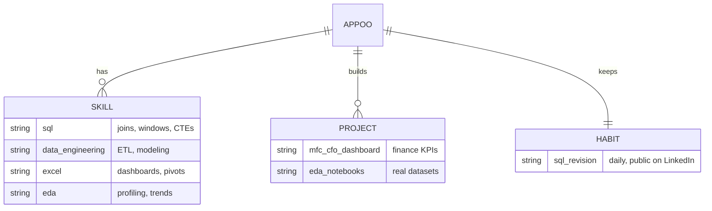
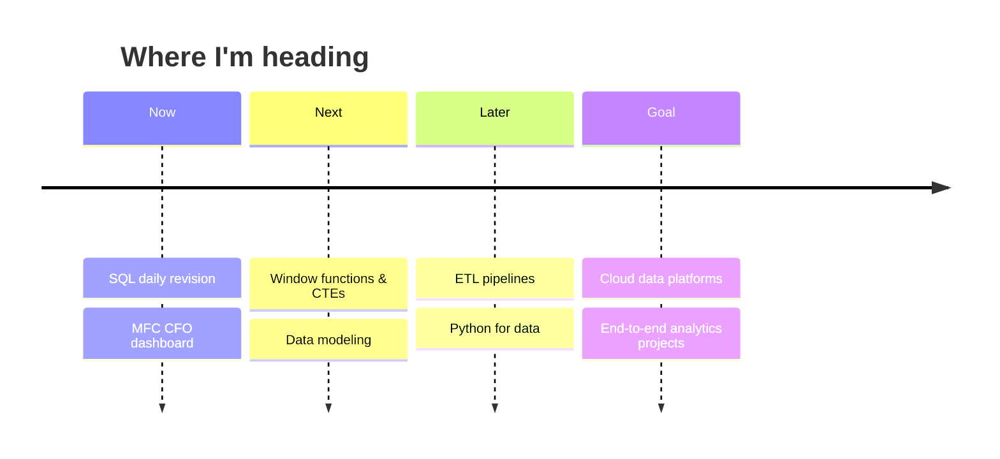

<!--
  SETUP
  1. Repo name must equal your GitHub username (public repo)
  2. Upload this whole folder: README.md, assets/, .github/
  3. Replace YOUR_USERNAME, YOUR_LINKEDIN, YOUR_EMAIL everywhere
-->

<div align="center">
  
</div>

<div align="center">
  
</div>

<br/>

<div align="center">
  
  
  
  
  
</div>

<br/>

<div align="center">
  
</div>

---

## `01` &nbsp;What I do

<table>
<tr>
<td width="33%" valign="top">

### 🧮 Query
Writing SQL that is readable first and fast second: joins, aggregations, window functions, CTEs.

</td>
<td width="33%" valign="top">

### 🏗️ Engineer
Cleaning, modeling and moving data so analysis starts from a trustworthy base.

</td>
<td width="33%" valign="top">

### 📊 Communicate
Excel dashboards and EDA that turn numbers into a story a CFO can act on.

</td>
</tr>
</table>

---

## `02` &nbsp;Data model of me



---

## `03` &nbsp;Tech stack

<div align="center">


</div>

<details>
<summary><b>Skill depth, at a glance</b></summary>
<br/>

| Skill | Level | Focus |
|:--|:--|:--|
| SQL | 🟦🟦🟦🟦⬜ | Foundations → joins → window functions |
| Excel dashboards | 🟦🟦🟦🟦⬜ | KPIs, pivots, executive views |
| EDA | 🟦🟦🟦⬜⬜ | Profiling, outliers, trends |
| Data engineering | 🟦🟦🟦⬜⬜ | ETL, modeling, pipelines |
| Python for data | 🟦🟦⬜⬜⬜ | Pandas, notebooks |

<sub>Adjust the blocks to your honest self-assessment.</sub>

</details>

---

## `04` &nbsp;Featured work

| Project | What it does | Stack |
|:--|:--|:--|
| 📦 **[MFC CFO Dashboard](https://github.com/YOUR_USERNAME/YOUR_REPO)** | Executive dashboard giving finance leadership a clear view of a micro fulfillment center's performance | Excel · SQL |
| 🔥 **[SQL Revision Series](https://github.com/YOUR_USERNAME/YOUR_REPO)** | Daily revision notes and practice queries, from foundations upward | SQL |
| 🔍 **[EDA Notebooks](https://github.com/YOUR_USERNAME/YOUR_REPO)** | Clean, profile and visualize real datasets to surface insight fast | Python · Pandas |
| ⚙️ **[ETL Practice](https://github.com/YOUR_USERNAME/YOUR_REPO)** | Small pipelines and modeling exercises to build engineering fundamentals | SQL · Python |

---

## `05` &nbsp;SQL revision streak

```sql
-- Progress tracker
SELECT module, status
FROM   sql_revision
ORDER  BY module;
```

| # | Module | Status |
|:-:|:--|:-:|
| 1 | Foundations: basics, DDL, DML, keys, constraints, filtering | ✅ |
| 2 | Joins & aggregations | 🔄 |
| 3 | Window functions, CTEs, subqueries | ⏳ |
| 4 | Optimization: indexes, query plans | ⏳ |

> Following along on **[LinkedIn](https://www.linkedin.com/in/YOUR_LINKEDIN)**. Update the statuses as you go.

---

## `06` &nbsp;Roadmap



---

## `07` &nbsp;GitHub activity

<div align="center">
  
  
</div>

<div align="center">
  
</div>

<div align="center">
  
</div>

---

## `08` &nbsp;Beyond the data

🎬 I also edit video and play with cinematic effects, which taught me that good visuals and good analysis share one rule: **clarity wins**.

---

## `09` &nbsp;Connect

<div align="center">
  <a href="https://www.linkedin.com/in/YOUR_LINKEDIN"></a>
  <a href="mailto:YOUR_EMAIL@example.com"></a>
</div>

<br/>

<div align="center">
  <sub><code>SELECT 'Thanks for visiting' AS message, '🚀' AS vibe;</code></sub>
</div>
