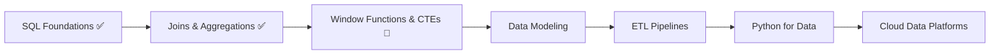

<!-- ============================================================
  HOW TO USE
  1. Create a public repo named EXACTLY your GitHub username
  2. Add this file as README.md
  3. Find & replace YOUR_USERNAME with your GitHub username
  4. Update the links in the "Connect" section
============================================================ -->

<!-- Animated header banner -->
<div align="center">
  
</div>

<!-- Typing animation -->
<div align="center">
  <a href="https://git.io/typing-svg">
    
  </a>
</div>

<div align="center">
  
  
  
</div>

---

## 👨‍💻 About Me

```python
class Appoo:
    def __init__(self):
        self.role      = "Data & Analytics Professional"
        self.focus     = ["SQL", "Data Engineering", "Excel Dashboards", "EDA"]
        self.currently = "Revising SQL daily & building business dashboards"
        self.learning  = ["Advanced SQL", "ETL Pipelines", "Python for Data", "Power BI"]
        self.motto     = "Good data tells a story. Great analysis changes a decision."

    def say_hi(self):
        print("Thanks for stopping by! Let's talk data 📊")

me = Appoo()
me.say_hi()
```

- 🔭 **Working on:** a CFO-focused dashboard for a micro fulfillment center (MFC) business
- 🔥 **Daily habit:** a SQL revision streak, shared publicly on LinkedIn
- 🌱 **Learning:** data engineering concepts, pipelines, and advanced SQL
- 📊 **Love:** turning messy datasets into clear, actionable insights
- 💬 **Ask me about:** SQL, Excel dashboards, EDA, data cleaning
- ⚡ **Fun fact:** I also enjoy video editing and cinematic effects 🎬

---

## 🛠️ Tech Stack & Tools

<div align="center">

**Languages & Querying**


**Data & Analytics**


**Tools & Workflow**


</div>

<details>
<summary><b>📚 Skill breakdown (click to expand)</b></summary>

| Area | What I work with |
|------|------------------|
| **SQL** | DDL, DML, keys & constraints, filtering, joins, aggregations, window functions, subqueries, CTEs |
| **Data Engineering** | ETL concepts, data modeling, cleaning & transformation, pipeline thinking |
| **Excel** | Dashboards, pivot tables, advanced formulas, KPI tracking, charts |
| **EDA** | Profiling, outlier detection, distribution analysis, trend & correlation discovery |
| **Visualization** | Executive dashboards, storytelling with data |

</details>

---

## 🚀 Featured Projects

<div align="center">
<table>
  <tr>
    <td width="50%" valign="top">
      <h3>📦 MFC CFO Dashboard</h3>
      <p>An executive dashboard for a micro fulfillment center business, built to give finance leadership a clear view of performance.</p>
      <p><b>Focus:</b> KPIs, cost tracking, operational metrics</p>
      <p><b>Tools:</b> Excel, SQL</p>
      <a href="https://github.com/YOUR_USERNAME/YOUR_REPO"></a>
    </td>
    <td width="50%" valign="top">
      <h3>🗃️ SQL Revision Series</h3>
      <p>A daily SQL revision streak covering foundations through advanced topics, with notes and practice queries.</p>
      <p><b>Focus:</b> Consistency, concept clarity, interview prep</p>
      <p><b>Tools:</b> SQL, GitHub, LinkedIn</p>
      <a href="https://github.com/YOUR_USERNAME/YOUR_REPO"></a>
    </td>
  </tr>
  <tr>
    <td width="50%" valign="top">
      <h3>🔍 Exploratory Data Analysis</h3>
      <p>Notebooks that clean, profile, and visualize real-world datasets to surface insights quickly.</p>
      <p><b>Focus:</b> Data quality, patterns, storytelling</p>
      <p><b>Tools:</b> Python, Pandas, Excel</p>
      <a href="https://github.com/YOUR_USERNAME/YOUR_REPO"></a>
    </td>
    <td width="50%" valign="top">
      <h3>⚙️ Data Engineering Practice</h3>
      <p>Small ETL pipelines and data modeling exercises to build real engineering fundamentals.</p>
      <p><b>Focus:</b> Pipelines, modeling, automation</p>
      <p><b>Tools:</b> SQL, Python</p>
      <a href="https://github.com/YOUR_USERNAME/YOUR_REPO"></a>
    </td>
  </tr>
</table>
</div>

---

## 📈 GitHub Stats

<div align="center">
  
  
</div>

<div align="center">
  
</div>

<div align="center">
  
</div>

<div align="center">
  
</div>

---

## 🗺️ My Learning Roadmap



---

## 🔥 SQL Revision Streak

> Revising SQL every single day and sharing it publicly, because consistency beats intensity.

| Module | Topics | Status |
|--------|--------|--------|
| 1. Foundations | SQL basics, DDL, DML, keys, constraints, filtering | ✅ Done |
| 2. Joins & Aggregations | Inner/outer joins, GROUP BY, HAVING | 🔄 In progress |
| 3. Advanced SQL | Window functions, CTEs, subqueries | ⏳ Upcoming |
| 4. Optimization | Indexes, query plans, performance tuning | ⏳ Upcoming |

📣 Follow the streak on [LinkedIn](https://www.linkedin.com/in/YOUR_LINKEDIN)

---

## 🐍 Contribution Snake

<div align="center">
  
</div>

<details>
<summary>⚙️ <b>How to enable the snake animation</b></summary>

Create `.github/workflows/snake.yml` in your profile repo:

```yaml
name: Generate Snake
on:
  schedule:
    - cron: "0 0 * * *"
  workflow_dispatch:
  push:
    branches: [main]

permissions:
  contents: write

jobs:
  generate:
    runs-on: ubuntu-latest
    steps:
      - uses: Platane/snk/svg-only@v3
        with:
          github_user_name: ${{ github.repository_owner }}
          outputs: |
            dist/github-snake-dark.svg?palette=github-dark
      - uses: crazy-max/ghaction-github-pages@v3.1.0
        with:
          target_branch: output
          build_dir: dist
        env:
          GITHUB_TOKEN: ${{ secrets.GITHUB_TOKEN }}
```

</details>

---

## 🤝 Let's Connect

<div align="center">
  <a href="https://www.linkedin.com/in/YOUR_LINKEDIN"></a>
  <a href="mailto:YOUR_EMAIL@example.com"></a>
  <a href="https://YOUR_PORTFOLIO_URL"></a>
</div>

---

## 💡 Quote of the Day

<div align="center">
  
</div>

<div align="center">
  
</div>


